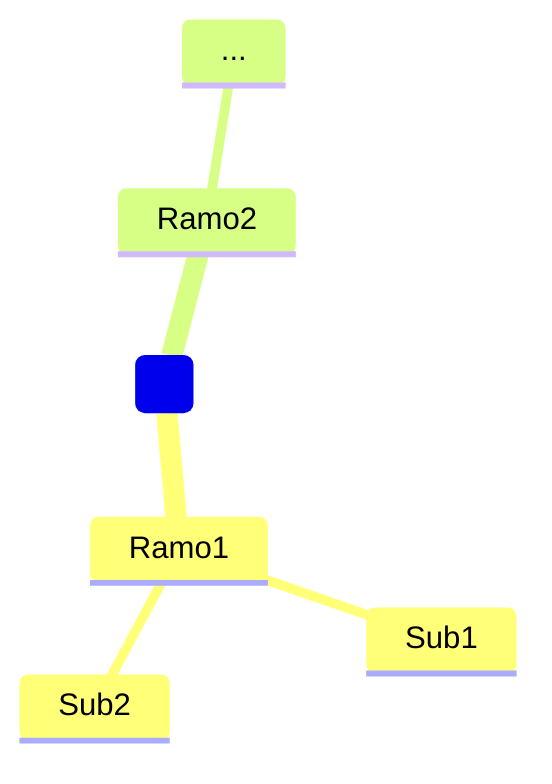

# Pipeline de Geração de Apostila — 9 Estágios

Este documento descreve a arquitetura completa do pipeline que o agente deve executar para gerar uma apostila de concurso público.

---

## Visão Geral

```
EDITAL (PDF/URL/inferência)
    │
    ▼
[0] INGESTÃO E PARSING
    │
    ▼
[1] VERTICALIZAÇÃO E MODELAGEM DO ESCOPO
    │
    ▼
[2] PERFILAMENTO DA BANCA
    │
    ▼
[3] PLANEJAMENTO DE CAPÍTULOS E METAS DE APRENDIZAGEM
    │
    ▼
[4] CURADORIA DE FONTES E BASE FACTUAL
    │
    ▼
[5] REDAÇÃO DA TEORIA
    │
    ▼
[6] PRODUÇÃO DE DERIVADOS
    │
    ▼
[7] QUESTÕES E COMENTÁRIOS
    │
    ▼
[8] QA, VALIDAÇÃO E PUBLICAÇÃO
    │
    ▼
apostila_gerada/
```

---

## Estágio 0 — Ingestão e Parsing

**Objetivo:** extrair informações estruturadas do edital.

**Entrada:** PDF via URL (`EDITAL_URL`) ou arquivo local (`EDITAL_ARQUIVO_LOCAL`), ou modo inferência (pré-edital).

**Extrair obrigatoriamente:**
- Órgão, banca, cargo, número do edital, ano
- Data da prova (se disponível)
- Número de questões por disciplina e pesos
- Notas mínimas (geral e por disciplina, se houver)
- Penalização por erro (sim/não)
- Etapas eliminatórias (prova discursiva, TAF, PS, etc.)
- **Conteúdo programático completo** (hierárquico, com numeração original)
- Legislação listada (leis por número, ano, data de vigência exigida)
- Bibliografia indicada (se houver)
- Hipóteses de reserva de vagas (PcD, PPP, CR)

**Regra:** preservar o texto literal dos itens do conteúdo programático. Não resumir, não interpretar, não acrescentar itens.

**Saída:** `PLAN.md` com todos esses dados preenchidos.

---

## Estágio 1 — Verticalização e Modelagem do Escopo

**Objetivo:** transformar o conteúdo programático em estrutura hierárquica navegável.

**Formato JSON interno:**
```json
[
  {
    "id": "1",
    "disciplina": "Língua Portuguesa",
    "grupo": "básicos",
    "peso_percentual": 20,
    "n_questoes": 10,
    "nota_minima": null,
    "topicos": [
      {
        "id": "1.1",
        "nivel": 1,
        "numero_edital": "1",
        "texto": "Compreensão e interpretação de textos de gêneros variados.",
        "filhos": []
      }
    ]
  }
]
```

**Detectores obrigatórios:**
- Há nota mínima por disciplina? → se sim, cobertura 100% é obrigatória
- Há penalização por erro? → afeta estratégia de questões e dicas
- O edital tem bibliografia? → vira fonte preferencial da teoria

**Saída:** tabela de Status de Cobertura no `PLAN.md`.

---

## Estágio 2 — Perfilamento da Banca

**Objetivo:** carregar as características da banca para parametrizar toda a geração.

**Leia:** `docs/bancas/<BANCA_NOME>.md`

**Parâmetros que afetam o pipeline:**

| Parâmetro | Efeito |
|---|---|
| Formato de item | Estrutura das questões geradas |
| Penalização | Dicas de gestão de prova e estratégia |
| Exigência de jurisprudência | Volume de boxes de jurisprudência |
| Estilo de linguagem | Tom dos distratores (literal vs. caso fático) |
| Profundidade típica | Nível de detalhamento da teoria |
| Pegadinhas características | Boxes de ATENÇÃO personalizados |

---

## Estágio 3 — Planejamento de Capítulos

**Objetivo:** organizar os itens do edital em aulas pedagogicamente coerentes.

**Regras:**
- Agrupar itens que formam uma unidade conceitual (não dividir um tema em excesso).
- Seguir sequência lógica da disciplina (do geral ao específico), mas honrando a numeração do edital como referência.
- Para cada aula, definir:
  - Título
  - Objetivo de aprendizagem (verbo de Bloom: identificar, distinguir, aplicar, analisar)
  - Itens do edital cobertos (IDs)
  - Orçamento: páginas estimadas de teoria, número de questões, recursos derivados

**Saída:** seção "Plano de Capítulos" no `PLAN.md`.

---

## Estágio 4 — Curadoria de Fontes e Base Factual

**Objetivo:** identificar e indexar as fontes que sustentarão a teoria.

**Fontes obrigatórias (por tipo de disciplina):**

| Tipo | Fontes |
|---|---|
| Disciplinas jurídicas | Texto de lei (Planalto.gov.br), súmulas STF/STJ, informativos recentes |
| Contabilidade/Finanças | Lei 4.320/64, Lei 101/00, NBC, normas CFC |
| TI/Informática | Normas ABNT NBR ISO 27001/27002, manuais oficiais, RFC |
| Português | Ortografia oficial (VOLP), gramáticas de referência (Cunha & Cintra, Bechara) |
| Raciocínio Lógico | Nenhuma fonte externa — geração baseada em estrutura lógica |
| Conhecimentos gerais | Fontes oficiais (IBGE, MEC, Planalto) + atualidades do período |

**Regra RAG:** toda afirmação normativa na teoria deve vir de uma fonte recuperada. Se a fonte não estiver disponível no contexto, escreva `[VERIFICAR FONTE]` e continue. **Nunca inventar artigo, prazo, percentual ou súmula.**

**Data-limite:** verificar `EDITAL_DATA_LIMITE_LEGISLACAO`. Legislação alterada após essa data pode não ser cobrada — sinalizar quando relevante.

---

## Estágio 5 — Redação da Teoria

**Objetivo:** escrever o conteúdo teórico de cada aula.

> ⚠️ **REGRA DE AUTOSSUFICIÊNCIA TEXTUAL:** O texto deve ser lido como um livro/apostila contínua. Nunca cite nomes de arquivos internos (`teoria.md`, `resumo.md`, `questoes_treino.md`, `flashcards.csv`, etc.). Use remissões pedagógicas: *"veja na seção de Resumo"*, *"passe para as Questões de Treino"*, *"consulte os comentários na seção seguinte"*.

**Estrutura interna obrigatória de `teoria.md`:**

```markdown
# Aula X — <Título>

> **Itens do edital cobertos:** <lista de IDs e texto do edital>
> **Objetivo de aprendizagem:** ao final desta aula, você será capaz de <verbo Bloom>.
> **Tempo estimado:** <X> minutos de leitura + <Y> minutos de questões

---

## 1. <Conceito/Definição>
<prosa clara; termos técnicos definidos na 1ª ocorrência>

## 2. Base Legal
<transcrição do(s) dispositivo(s) relevante(s)>
> (Art. X, Lei nº Y/AAAA)

## 3. <Desenvolvimento / Espécies / Requisitos / Procedimento>
<teoria sequenciada>

## 4. Jurisprudência  ← (apenas se APOSTILA_INCLUIR_JURISPRUDENCIA=true)
> ⚖️ **JURISPRUDÊNCIA:** <Tribunal, nº, enunciado>

## 5. Exemplos e Casos Concretos
<exemplos práticos; quando for FGV, incluir caso fático>

> ⚠️ **ATENÇÃO — PEGADINHA DA BANCA:** <texto>

> 🔍 **NÃO CONFUNDA:** X ≠ Y — <explicação>

## 6. Síntese
<5 linhas máximo; os pontos mais cobrados em prova>

> 📋 **RESUMO DO TÓPICO:**
> - ponto 1
> - ponto 2
> - ponto 3

> ❓ **CHECKPOINT:** <pergunta de fixação para o leitor>
```

**Linguagem:**
- Frases curtas, voz ativa.
- Dialógica: "observe que", "atenção para", "veja bem".
- Sem jargão sem definição.
- Sem generalizações ("sempre", "nunca") sem base legal explícita.

---

## Estágio 6 — Produção de Derivados

Para cada aula, gerar:

### `resumo.md`
Síntese em tópicos e tabelas. Máximo 2 páginas. Deve ser revisável em 5 minutos.

Estrutura:
```markdown
# Resumo — <Título da Aula>

## Conceito Central
<1-2 linhas>

## Base Legal
| Lei | Artigo | Regra |
|---|---|---|

## Pontos-Chave
- item 1
- item 2

## Diferenciações Importantes
| Instituto A | Instituto B |
|---|---|

## Pegadinhas Frequentes
1. <texto>

## Revisão Espaçada
- D+1: releia este resumo
- D+7: refaça as questões de treino
- D+30: refaça o flashcard deck desta aula
```

### `mapa_mental.md`
```markdown
# Mapa Mental — <Título da Aula>

## Estrutura
- **Centro:** <tema central>
- **Ramo 1:** <tópico>
  - Sub-ramo 1.1: <palavra-chave>
  - Sub-ramo 1.2: <palavra-chave>
- **Ramo 2:** ...

## Código Mermaid


## Descrição Textual (Acessibilidade)
<descrição em prosa do mapa para leitores de tela>
```

### `flashcards.csv`
```
frente;verso;tags
"O que é ato administrativo?";"`Manifestação unilateral de vontade da AP que produz efeitos jurídicos (Art. 2º, Lei 9.784/99)`";"direito-administrativo;ato-administrativo;conceito"
```

---

## Estágio 7 — Questões e Comentários

### `questoes_treino.md`
```markdown
# Questões de Treino — <Título da Aula>

**Instrução:** responda antes de ver o gabarito.

---

**Questão 1** (Banca, Órgão, Ano — se for de prova real; ou "Inédita — estilo <Banca>")
<enunciado>

(A) ...
(B) ...
(C) ...
(D) ...
(E) ...

---
...

## Gabarito
1-B | 2-C | 3-A | ...
```

### `questoes_comentadas.md`
```markdown
# Questões Comentadas — <Título da Aula>

---

**Questão 1** ...
<enunciado>

**Gabarito:** B

**Por que B está correta:**
<explicação com fundamento: Art. X, Lei Y>

**Por que A está errada:**
<erro representado pelo distrator>

**Por que C está errada:**
...

> 📌 **Como a banca cobra:** <padrão típico da banca neste tema>
> ⚠️ **Cuidado:** <erro recorrente dos candidatos>
```

**Regras de geração de questões:**
- Priorizar provas anteriores da banca no cargo (citar fonte: Banca, Órgão, Ano, Nº questão).
- Completar com questões inéditas no estilo da banca quando houver lacunas.
- Balancear: 30% fácil, 50% médio, 20% difícil.
- Para CEBRASPE: itens independentes, C/E inequívoco, aplicar no máximo 2 armadilhas por item.
- Cada distrator deve representar um erro conceitual plausível, não um absurdo.
- Nunca usar pegadinha gratuita (erro de digitação como armadilha).

---

## Estágio 8 — QA, Validação e Publicação

**Executar antes de encerrar:**

1. **Checklist de cobertura:** verificar que cada item do edital tem capítulo correspondente.
2. **Checklist de rastreabilidade:** cada `teoria.md` tem pelo menos uma citação de fonte por afirmação normativa.
3. **Checklist de recursos:** cada aula tem os 6 arquivos obrigatórios.
4. **Checklist de autossuficiência:** nenhuma referência mecânica a arquivos `.md`, `.csv` ou do sistema no corpo do texto da apostila.
5. **Alerta de vigência:** checar se alguma lei citada foi alterada após `EDITAL_DATA_LIMITE_LEGISLACAO`.
6. **Consistência de gabaritos:** verificar que nenhuma questão tem gabarito ambíguo.
7. **Revisão do `sumario.md`:** confirmar que todos os capítulos estão listados com número de item do edital e sem nomes de arquivos em disco.

**Registrar resultado no `HISTORY.md`** com data, o que foi validado e qualquer pendência.

---

## Dependências entre Estágios

```
0 → 1 → 2 → 3 (paralelo) → 4
                              └→ 5 → 6 → 7 → 8
```

Os estágios 5, 6 e 7 podem ser executados por disciplina em paralelo (uma disciplina não bloqueia outra), mas dentro de cada disciplina devem ser sequenciais (teoria → derivados → questões).

---

## Modo Pré-Edital

Quando `EDITAL_STATUS=previsto`:

1. **Estágio 0** usa inferência em vez de parsing:
   - Baixar/ler editais anteriores (URLs em `PRE_EDITAL_EDITAIS_ANTERIORES`)
   - Buscar editais de órgãos análogos (`PRE_EDITAL_ORGAOS_ANALOGOS`)
   - Consultar histórico de provas da banca para o cargo
   - Levantar legislação estruturante da área (invariante entre editais)

2. Cada item do conteúdo inferido recebe uma etiqueta:
   - `[INFERIDO-HISTÓRICO]` — presente em 3+ editais anteriores
   - `[INFERIDO-ANÁLOGO]` — presente em editais de órgãos análogos
   - `[LEGISLAÇÃO-ESTRUTURANTE]` — lei fundamental da área, cobre independente do edital
   - `[BAIXA-CONFIANÇA]` — inferência fraca; marcar para revisão quando o edital sair

3. Todo arquivo gerado começa com:
   ```
   > ⚠️ MATERIAL PRÉ-EDITAL
   > Baseado em: <fonte1>, <fonte2>
   > Confiança do item: <ALTA | MÉDIA | BAIXA>
   > Atualizar quando o edital oficial for publicado.
   ```
