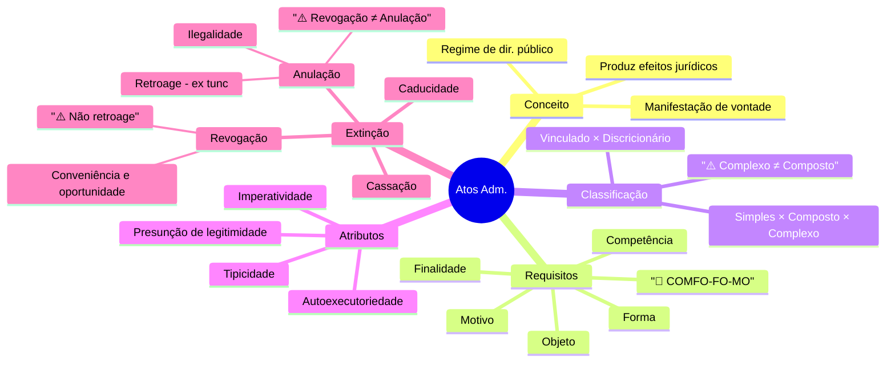
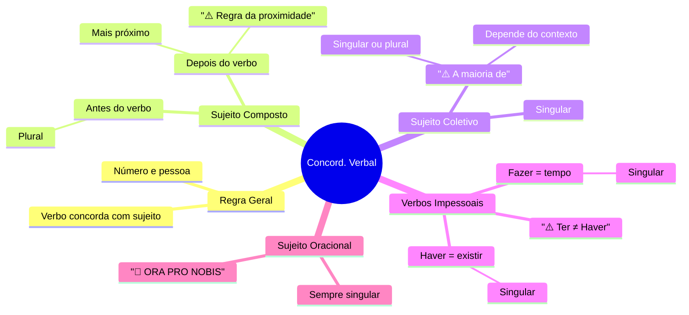

# Prompt G — Geração de Mapa Mental

## Metadados
- **Estágio do pipeline:** 6 — Mapa Mental
- **Input:** Teoria da aula + resumo da aula
- **Output:** Arquivo `mapa_mental.md` com estrutura radial, código Mermaid e descrição textual de acessibilidade
- **Quando usar:** Após a teoria estar pronta; uma vez por aula

---

## Instruções de Uso

### Quando usar este prompt
- Uma vez por aula, após a teoria e o resumo estarem prontos
- Para regenerar o mapa quando o conteúdo da teoria for atualizado
- Para gerar mapas mentais de disciplinas completas (mapa de disciplina = nós de 1º nível são as aulas)

### Como preencher os campos variáveis

| Marcador | O que inserir |
|---|---|
| `{{TEORIA_AULA}}` | Texto completo da teoria |
| `{{RESUMO_AULA}}` | Texto do resumo (se já gerado) ou null |
| `{{DISCIPLINA}}` | Nome da disciplina |
| `{{TITULO_AULA}}` | Título da aula |
| `{{BANCA}}` | Nome da banca |
| `{{CARGO}}` | Cargo |
| `{{MAX_NOS}}` | Número máximo de nós no mapa (padrão: 40) |

---

## O Prompt

```
Você é um especialista em design instrucional e síntese de conteúdo para concursos públicos, com experiência em mapas mentais para estudo de alto desempenho.

## CONTEXTO
- Disciplina: {{DISCIPLINA}}
- Aula: {{TITULO_AULA}}
- Cargo: {{CARGO}}
- Banca: {{BANCA}}
- Máximo de nós: {{MAX_NOS}}

## TEORIA DA AULA
{{TEORIA_AULA}}

## RESUMO DA AULA (se disponível)
{{RESUMO_AULA}}

---

## TAREFA
Produza o arquivo `mapa_mental.md` completo, com as três seções obrigatórias:
1. Estrutura radial descritiva
2. Código Mermaid renderizável
3. Descrição textual de acessibilidade

---

## REGRAS DE CONSTRUÇÃO DO MAPA MENTAL

### REGRAS DE ESTRUTURA
1. **Nó central:** Título da aula — deve ser curto (máximo 4 palavras).
2. **Nós de 1º nível (ramos principais):** Os grandes blocos temáticos da aula — máximo 7, mínimo 3.
3. **Nós de 2º nível (sub-ramos):** Conceitos, elementos, classificações — máximo 5 por ramo de 1º nível.
4. **Nós de 3º nível (folhas):** Detalhes críticos, prazos, números, pegadinhas — apenas para itens essenciais.
5. **Profundidade máxima:** 3 níveis (central → 1º → 2º → 3º). Não exceder.
6. **Total de nós:** Máximo {{MAX_NOS}} incluindo o central.

### REGRAS DE CONTEÚDO
1. **Prioridade de conteúdo:** Pontos mais cobrados na prova → elementos estruturantes → detalhes relevantes.
2. **Linguagem dos nós:** Rótulos curtos (2–5 palavras) — nós não são frases completas.
3. **Pegadinhas como nós especiais:** Marque com ⚠️ itens que são pegadinhas frequentes da banca.
4. **Prazos e números:** Inclua como nós de 3º nível quando for item de prova frequente.
5. **Bases legais:** Inclua o número da lei/artigo como nó filho do conceito correspondente.
6. **Mnemônicos:** Inclua como nó de 2º ou 3º nível quando existirem — marcados com 🧠.

### REGRAS DO CÓDIGO MERMAID
1. Use o formato `mindmap` do Mermaid.
2. Nós de 1º nível: formato padrão.
3. Nós com ⚠️: indicar no rótulo do nó.
4. Nós com 🧠 (mnemônico): indicar no rótulo.
5. O código deve ser renderizável sem erros — testar mentalmente a sintaxe.
6. Use aspas nos rótulos que contêm caracteres especiais.
7. Limite linhas longas — rótulos com mais de 30 caracteres devem ser abreviados.

### REGRAS DE ACESSIBILIDADE
1. A descrição textual deve permitir que uma pessoa cega compreenda o mapa completo.
2. Descrever a hierarquia de forma sequencial: "O nó central X se ramifica em A, B e C. A se ramifica em..."
3. Incluir o conteúdo de TODOS os nós, em ordem do central para as folhas.

---

## FORMATO DE SAÍDA

```markdown
# Mapa Mental — {{TITULO_AULA}}
**Disciplina:** {{DISCIPLINA}} | **Banca:** {{BANCA}} | **Cargo:** {{CARGO}}

---

## 🗺️ Estrutura Radial

### Nó Central
**{{TITULO_AULA_CURTO}}**

### Ramos Principais (1º nível)
1. **[Ramo 1]** — <descrição do que contém>
2. **[Ramo 2]** — <descrição>
3. **[Ramo 3]** — <descrição>
[...]

### Sub-ramos (2º nível)
**[Ramo 1]:**
- [Sub-ramo 1.1]: <conteúdo>
- [Sub-ramo 1.2]: <conteúdo>
- ⚠️ [Sub-ramo 1.3 — Pegadinha]: <conteúdo>

**[Ramo 2]:**
- [Sub-ramo 2.1]: <conteúdo>
[...]

### Folhas (3º nível — itens críticos)
**[Ramo 1 → Sub-ramo 1.1]:**
- [Folha 1.1.1]: <prazo / número / lei>
- [Folha 1.1.2]: <exceção>

---

## 💻 Código Mermaid

```mermaid
mindmap
  root(({{TITULO_AULA_CURTO}}))
    [Ramo 1]
      [Sub-ramo 1.1]
        [Folha 1.1.1]
        [Folha 1.1.2]
      [Sub-ramo 1.2]
      "⚠️ Sub-ramo 1.3"
    [Ramo 2]
      [Sub-ramo 2.1]
      [Sub-ramo 2.2]
    [Ramo 3]
      [Sub-ramo 3.1]
      "🧠 Mnemônico: CADI"
        [C: Competência]
        [A: Adequação]
        [D: Determinação]
        [I: Interesse]
    [Ramo 4]
      [Sub-ramo 4.1]
      [Sub-ramo 4.2]
```

---

## ♿ Descrição Textual (Acessibilidade)

### Leitura Sequencial do Mapa Mental

O mapa mental desta aula tem como **nó central** "{{TITULO_AULA_CURTO}}".

Do nó central, partem **[N] ramos principais**:

**1. Ramo "[Ramo 1]"**
Este ramo cobre [descrição geral]. Ele se divide em [N] sub-ramos:
- Sub-ramo "[1.1]": [conteúdo — descreva o que representa, incluindo nós filhos]
- Sub-ramo "[1.2]": [conteúdo]
- Sub-ramo "[1.3 — Pegadinha ⚠️]": [conteúdo — alerte sobre a pegadinha]

**2. Ramo "[Ramo 2]"**
[...]

[Continue para todos os ramos]

### Resumo dos Itens Prioritários para Prova
Os pontos mais críticos do mapa, em ordem de importância para a banca {{BANCA}}:
1. <item mais cobrado>
2. <segundo mais cobrado>
3. <terceiro mais cobrado>
[...]

---

## 🔗 Conexões Transversais

> Itens que se conectam a outras aulas da disciplina:

| Nó deste Mapa | Conexão com | Aula Relacionada |
|---|---|---|
| [Sub-ramo X] | [conceito da outra aula] | Aula 0N — [Título] |
| [Sub-ramo Y] | [conceito] | Aula 0M — [Título] |

---
*Mapa gerado em: {{DATA_GERACAO}} | Baseado na teoria da Aula {{NUMERO_AULA}}*
```

---

## Exemplos de Mapas por Área

### Exemplo 1 — Direito Administrativo: Atos Administrativos



### Exemplo 2 — Língua Portuguesa: Concordância Verbal



### Exemplo 3 — Mapa de Disciplina Completa (Direito Constitucional)

```mermaid
mindmap
  root((Dir. Const.))
    Princípios Fundamentais
      Aula 01
    Direitos Fundamentais
      Aula 02
      "⚠️ Art. 5º completo"
    Org. do Estado
      Aula 03
    Org. dos Poderes
      Aula 04
    Tributos
      Aula 05
    Ordem Econômica
      Aula 06
    Ordem Social
      Aula 07
    Controle de Constitucionalidade
      Aula 08
      "Alta incidência {{BANCA}}"
```

---

## Checklist de Qualidade — Mapa Mental

**Estrutura**
- [ ] Nó central presente e com rótulo curto (máximo 4 palavras)
- [ ] Entre 3 e 7 ramos de 1º nível
- [ ] Máximo de 3 níveis de profundidade
- [ ] Total de nós ≤ {{MAX_NOS}}
- [ ] Nenhum ramo sem ao menos 1 sub-ramo

**Conteúdo**
- [ ] Todos os blocos temáticos da teoria representados
- [ ] Pegadinhas marcadas com ⚠️
- [ ] Mnemônicos incluídos (marcados com 🧠)
- [ ] Prazos e números críticos presentes como folhas
- [ ] Bases legais indicadas nos nós correspondentes

**Código Mermaid**
- [ ] Sintaxe `mindmap` correta
- [ ] Sem caracteres especiais sem aspas
- [ ] Rótulos com menos de 30 caracteres (ou abreviados)
- [ ] Código renderizável sem erros

**Acessibilidade**
- [ ] Todos os nós descritos na seção textual
- [ ] Hierarquia clara na descrição sequencial
- [ ] Lista de itens prioritários para a prova

**Conexões**
- [ ] Tabela de conexões transversais preenchida (ou marcada como "nenhuma")
